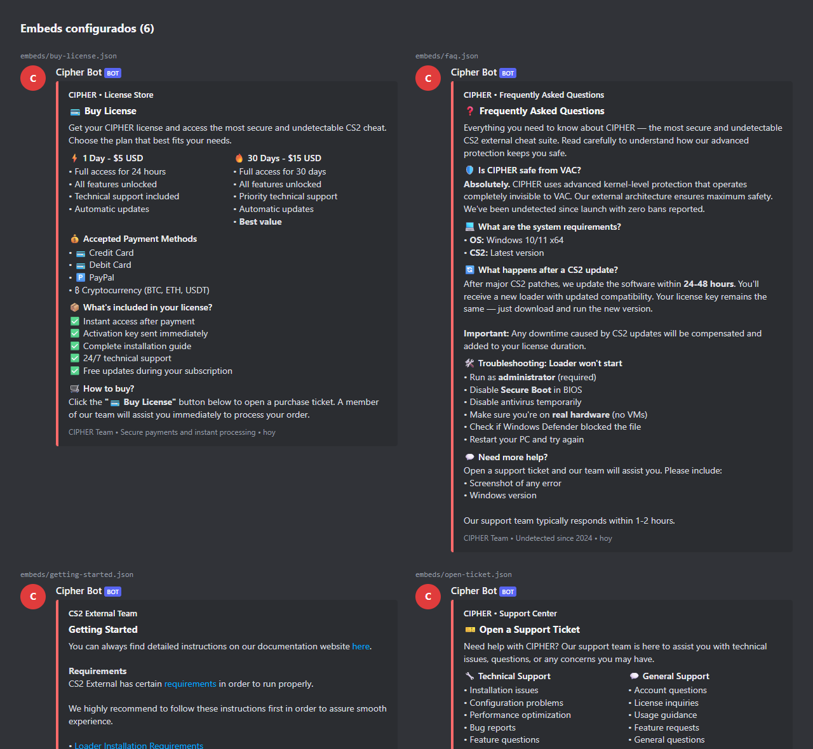

# Cipher Discord Bot

Bot de Discord en **TypeScript** para administrar el servidor de la comunidad de Cipher. Se encarga de tres cosas: la gestión del servidor (canales, categorías, roles y permisos) por comandos, la publicación de contenido (embeds definidos en JSON) y un **sistema de tickets de soporte** completo, con categorías, staff por categoría, transcripts, estadísticas y cierre automático por inactividad.



## Stack

| | |
| --- | --- |
| Lenguaje | TypeScript 5 (strict), Node.js 20+ |
| Discord | discord.js 14 |
| Logging | Winston (consola + archivo con rotación) |
| Tests | Jest + ts-jest: 20 suites, 284 tests |
| Ejecución | PM2 en un VPS Linux (`ecosystem.config.js`) |

## Funcionalidades

### Gestión del servidor

| Comando | Qué hace |
| --- | --- |
| `!createchannel` / `!createcategory` | Crea canales de texto o voz y categorías |
| `!movechannel` | Mueve un canal a otra categoría |
| `!createrole` / `!assignrole` / `!removerole` | Administración de roles |
| `!setpermissions` | Permisos de un rol sobre un canal |
| `!setservername` / `!setserverdescription` | Datos del servidor |
| `!sendembed <archivo>` | Publica un embed desde `embeds/*.json` |
| `!help [comando]` | Ayuda general o detallada |

Cada comando declara los permisos que necesita. El `CommandManager` los valida antes de ejecutarlo y responde con un error claro si el usuario no los tiene.

### Sistema de tickets

- **Panel con selector de categoría** (`!ticket-panel`): soporte técnico, ventas, etc. Cada categoría tiene su categoría de Discord y su propio rol de staff.
- **Canal privado por ticket**, con permisos solo para el usuario y el staff de esa categoría, numeración secuencial y límite de tickets abiertos por usuario.
- `!ticket-add` / `!ticket-remove` para sumar o sacar personas de un ticket, y `!ticket-close` o un botón para cerrarlo.
- **Transcript al cerrar**: se exporta toda la conversación, con metadatos y adjuntos, a un canal de logs.
- **Cierre automático por inactividad** (`InactivityMonitor`), con aviso previo configurable.
- **Estadísticas** (`!ticket-stats`): tickets abiertos y cerrados por categoría y tiempo promedio de resolución.
- Notificaciones al staff y registro de auditoría de cada acción.

## Arquitectura

```
src/
├── index.ts                  # Arranque: config → logger → cliente → managers → comandos → tickets
├── client/BotClient.ts       # Envoltorio de discord.js: intents, reconexión, eventos de shard
├── commands/                 # Un archivo por comando + CommandManager (registro, parseo, permisos)
├── managers/                 # Lógica de dominio desacoplada de los comandos
│   ├── ChannelManager.ts       canales y categorías
│   ├── RoleManager.ts          roles y asignaciones
│   ├── PermissionManager.ts    overwrites por rol/canal
│   ├── ServerManager.ts        datos del servidor
│   └── ConfigManager.ts        carga y validación de config.json / .env
├── tickets/
│   ├── TicketManager.ts        ciclo de vida del ticket
│   ├── TicketStorage.ts        persistencia en JSON (tickets, paneles, estadísticas)
│   ├── TicketPanelManager.ts   panel y menú de categorías
│   ├── InteractionHandlers.ts  botones y select menus
│   ├── TranscriptGenerator.ts  exportación de conversaciones
│   ├── InactivityMonitor.ts    cierre automático
│   ├── NotificationManager.ts  avisos al staff
│   └── LogManager.ts           auditoría
└── utils/                    # BotError (errores tipados con código), ErrorHandler, Logger
```

**Decisiones relevantes**

- **Comandos finos, managers con la lógica.** Los comandos solo parsean argumentos y delegan. Así la lógica se testea sin levantar Discord: los managers reciben dependencias mockeables.
- **Interfaces por componente** (`ITicketManager`, `ITicketStorage`, etc.) e inyección por constructor. Por eso los tests pueden reemplazar el almacenamiento o el cliente.
- **Errores tipados** (`BotError` con código y contexto): el `ErrorHandler` decide qué ve el usuario y qué se registra en el log.
- **Persistencia en JSON** para tickets y estadísticas. Alcanza para el volumen de una comunidad y no suma infraestructura. El acceso pasa por `TicketStorage`, así que cambiar a una base de datos no toca el resto del código.

## Embeds como contenido

Los mensajes fijos del servidor (bienvenida, reglas, FAQ, compra, primeros pasos, apertura de tickets) viven en `embeds/*.json` y se publican con `!sendembed`. Para revisarlos sin entrar a Discord:

```bash
node scripts/preview-embeds.mjs    # genera docs/embed-preview.html
```

La captura del principio y [la vista completa](docs/screenshots/embeds.png) salen de esa vista previa.

## Ejecutar localmente

```bash
npm ci
cp .env.example .env                    # DISCORD_TOKEN
cp config.example.json config.json      # IDs de roles y categorías del servidor
npm run build && npm start              # o: npm run dev (ts-node)
```

El bot necesita los intents `Guilds`, `GuildMessages`, `MessageContent` y `GuildMembers` habilitados en el portal de desarrolladores de Discord.

## Pruebas

```bash
npm test
```

Verificado el 28/10/2026: **20 suites, 284 tests, todos en verde**, y `tsc` compila sin errores. Los tests cubren managers, comandos, el ciclo completo de tickets, almacenamiento, transcripts, notificaciones y el manejo de errores, con mocks de discord.js.

## Despliegue

`ecosystem.config.js` (PM2, reinicio automático y logs) y `scripts/` (setup del VPS, deploy, backup de `data/` y monitoreo). Las direcciones del servidor se reemplazaron por marcadores.

Más documentación: [configuración del sistema de tickets](docs/ticket-system-config.md) y [manejo de errores](docs/error-handling.md).

## Licencia

Código propietario. Todos los derechos reservados.
